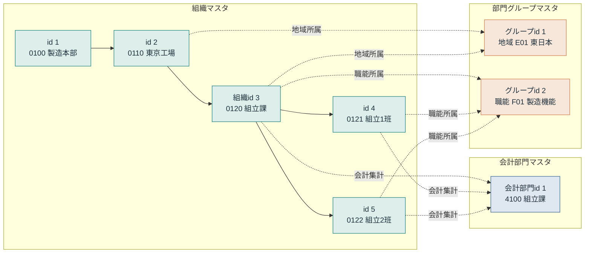
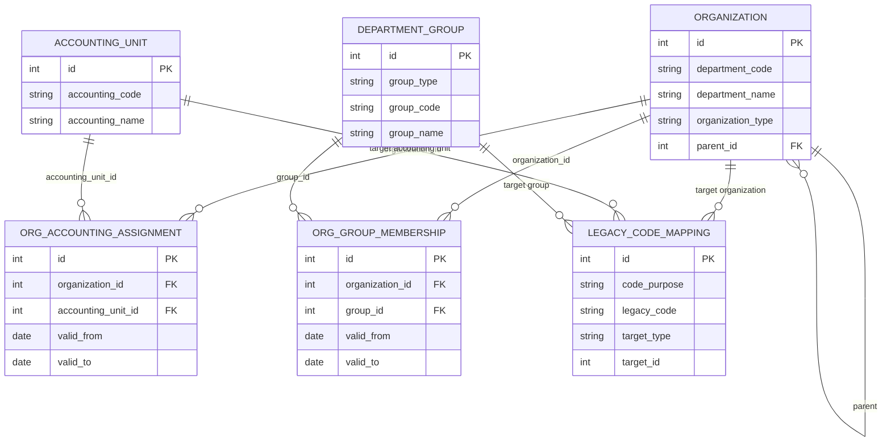
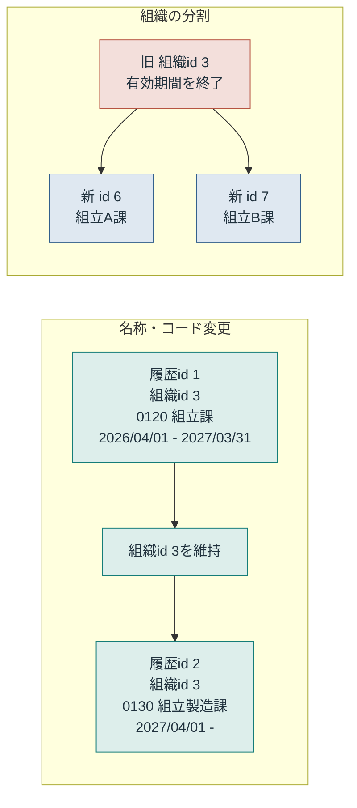

# 製造業ERP 組織マスタ設計 Mermaid図

このファイルの値は説明用のデータ例です。PowerPointと同じid・コードを使用しています。

## 1. 組織階層・会計集計・部門グループ

- 実線：所属組織の階層
- 点線：会計部門または部門グループとの対応
- 班は所属組織として管理し、原価は会計部門4100の組立課で集計します。

## 2. テーブル間の関係

idは意味を持たないサロゲートキーです。部門コード、会計部門コード、グループコードは業務上のナチュラルキーとして扱います。

## 3. 組織変更と履歴

名称・コード変更では組織idを維持します。組織の分割・統合では新しいidを発行し、終了したidを別の組織へ再利用しません。

## PowerPointとの対応

| Mermaid図 | PowerPoint |
|---|---|
| 図1 全体関係 | 3〜6枚目 |
| 図2 テーブル間の関係 | 3〜6枚目、9枚目 |
| 図3 組織変更と履歴 | 7〜8枚目 |

