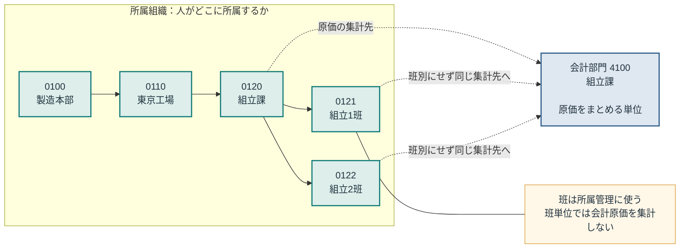
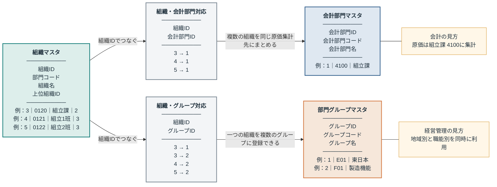
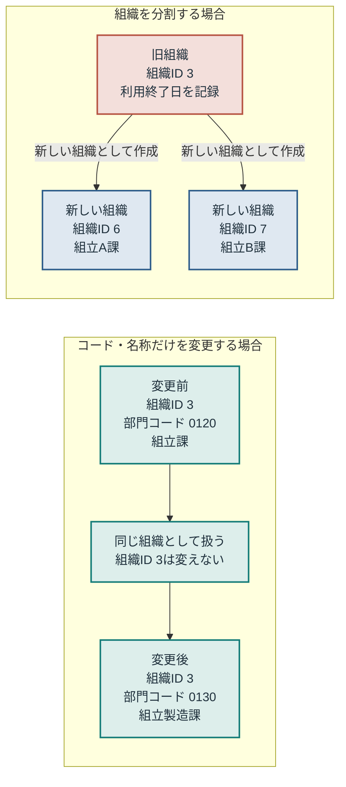

# 製造業ERP 組織マスタ設計 Mermaid図（非エンジニア向け）

対象読者は人事・経理・経営管理・情報管理の担当者です。図中の値は説明用の実データ例です。

> 読み方：**組織ID**はシステム内部で1から振る意味を持たない番号、**部門コード**は業務で利用する0100・0120などのコードです。

## 1. 所属と原価集計

**この図で伝えたいこと：** 班まで所属を管理しても、会計上の原価は組立課単位にまとめられます。

## 2. 3つのマスタとテーブル間の関係

**この図で伝えたいこと：** 組織を中心に、会計の集計先と経営管理の分類を別テーブルでつなぐことで、用途ごとの変更を切り離せます。

「組織・会計部門対応」は**複数の組織を同じ原価集計先にまとめる**ための表です。「組織・グループ対応」は**一つの組織を複数のグループに登録できる**ようにするための表です。

### 図2の実データの読み方

| 見たい内容 | 実データから分かること |
|---|---|
| 組立1班・2班の原価集計先 | 組織ID 4と5は、どちらも会計部門ID 1（4100 組立課）につながる |
| 組立課の経営管理上の分類 | 組織ID 3は、東日本（E01）と製造機能（F01）の両方につながる |
| 多対多にする理由 | 一つの組織に複数分類を付けられ、同じ分類に複数組織を登録できる |

## 3. 組織変更時に変わるもの

**この図で伝えたいこと：** コードや名称の変更では同じ組織IDを使い続け、組織を分割するときだけ新しい組織IDを発行します。

## PowerPointとの対応

| Mermaid図 | PowerPointの主な対応ページ |
|---|---|
| 図1 所属と原価集計 | 3〜6枚目 |
| 図2 3つのマスタとテーブル間の関係 | 3〜6枚目、9枚目 |
| 図3 組織変更時に変わるもの | 7〜8枚目 |

